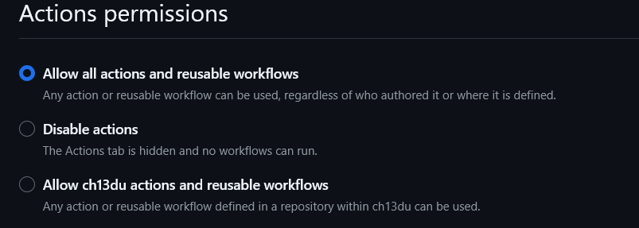

# Preliminary Technology Risk Review

## Risk ID
R-006

## Risk Category
CI/CD Security

## Risk Statement
Compromise of the deployment workflow or its
credentials may allow malicious code to be deployed
to the customer portal, affecting application integrity.

## Affected Assets
- GitHub Repository
- GitHub Actions
- Azure Static Web Apps

## Assessment Questions

1. What triggers the deployment?
Answer:

2. Who can modify the workflow?
Answer:

3. How are deployment credentials protected?
Answer:

4. What validation occurs before deployment?
Answer:

5. Are changes subject to approval?
Answer:

## Evidence Reviewed

## Preliminary Observations

## Assessment Limitations
No formal control effectiveness conclusion has
been reached at this stage.

## Next Action
Evaluate relevant controls during control testing.
